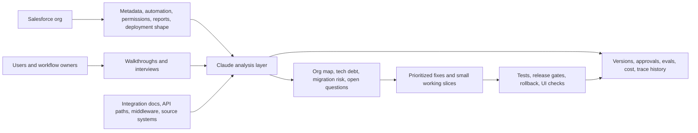

## Read the org before you design the answer

The most expensive phrase in a mature Salesforce org is, "We think that is how it works."

A field feeds a Flow. The Flow updates a record that triggers Apex. Apex calls middleware, and the operations team still keeps a spreadsheet because the record cannot be trusted. None of that fits cleanly into a requirements deck.

I start with the org itself. The first pass covers metadata, automation, permissions, integrations, deployment shape, old decisions, and the places where change is likely to hurt. In parallel, I watch people do the work. Metadata shows what can happen. A walkthrough shows what people actually depend on.

Claude comes after the evidence. It can hold scan output, interview notes, implementation docs, architecture diagrams, and migration artifacts in the same frame. That makes it useful for finding contradictions, grouping risk, and turning a pile of technical evidence into a decision someone can act on.

The goal is a better map and a safer next move. A chatbot can wait.

  

    <strong>Read the system</strong>
    Inventory metadata, automation, permissions, integrations, deployment paths, and stale configuration.
  

  

    <strong>Watch the work</strong>
    Capture walkthroughs, workarounds, exceptions, and the parts of the process that architecture documents miss.
  

  

    <strong>Make one move</strong>
    Fix the acute problem, keep the chronic one in view, and prove the change before widening the scope.
  

## What the first pass must answer

An org scan should answer practical questions:

- What does this org appear to do?
- Where does important behavior live?
- Which outside systems participate in the workflow?
- What looks stale, duplicated, fragile, or over-permissioned?
- What cannot be known under a metadata-only boundary?
- Which small fix would make the next change safer or easier?

  <article>
    
Org map

    
Scan objects, fields, automation, permissions, reports, packages, integrations, and deployment configuration. Explain what exists in language an operator can follow.

    
<strong>Proof:</strong> a new team member can understand the system without relying on one tribal-knowledge owner.

  </article>
  <article>
    
Tech debt and permission review

    
Find stale fields, overlapping automation, risky access patterns, brittle Flows, missing tests, and configuration that slows every release.

    
<strong>Proof:</strong> the backlog gets smaller, clearer, and tied to evidence.

  </article>
  <article>
    
Integration map

    
Trace connected systems, source-of-truth rules, triggers, join keys, middleware, failure paths, and ownership boundaries.

    
<strong>Proof:</strong> fewer dependencies appear for the first time during a migration or production change.

  </article>
  <article>
    
Migration readiness

    
Compare source and target models, flag mapping gaps, draft transformation rules, and define validation before cutover pressure starts.

    
<strong>Proof:</strong> the team can see what will move, what needs a decision, and what could be lost.

  </article>
  <article>
    
Release-path repair

    
Improve tests, CI, validation scripts, deployment notes, rollback steps, and UI smoke checks where the workflow reaches the browser.

    
<strong>Proof:</strong> a small fix can reach production without becoming a release project.

  </article>
  <article>
    
Workflow cleanup

    
Use walkthroughs to find duplicate entry, manual handoffs, spreadsheet shadows, and exceptions the official process ignores.

    
<strong>Proof:</strong> people feel an improvement while the deeper architecture work continues.

  </article>

Sales, service, onboarding, billing, and support are common starting points because the handoffs are visible and the cost of missing context is easy to recognize. The right starting workflow is the one with a real owner, repeated friction, and enough evidence to tell whether a change helped.

## The evidence path

Start with the smallest evidence surface that can answer the question. A checked-out metadata repo, safe describe output, deployment configuration, architecture notes, integration documentation, and a few recorded walkthroughs are often enough for the first map.

Add Slack, Google Drive, a warehouse, MuleSoft, or another system only when the workflow crosses that boundary. A broad connector list creates access risk before it creates understanding.

[Kicksights](https://kicksights.com/) is where I am turning this approach into a product. It helps consultancies and smaller teams understand what is really inside a Salesforce org, get more from the parts that still earn their keep, and define an exit path when a workflow belongs somewhere else.

### What each part owns

| Component | Job | Control |
|---|---|---|
| Org scanner | Inventory objects, fields, automation, permissions, packages, integrations, and release configuration. | Repeatable method, versioned output, documented blind spots. |
| Salesforce metadata access | Supply current-state evidence without starting in customer records. | Read-only first, least privilege, explicit metadata and data boundary. |
| Claude | Compare evidence, explain patterns, group risk, and draft next actions. | Versioned prompts, human review, evals, cost tracking, no unauthorized actions. |
| Walkthroughs | Show the real workflow, manual compensation, and exceptions. | Consent, source attribution, and clear separation of observation from interpretation. |
| Integration and migration artifacts | Capture systems, mappings, transformation rules, validation, and cutover questions. | Named owners, versioned schemas, exception handling, audit trail. |
| Delivery pipeline | Turn accepted findings into tests, fixes, release notes, and rollback paths. | Reproducible checks, explicit approvals, fast feedback. |
| Evaluation and audit | Track evidence, output versions, approvals, rejected findings, cost, and outcomes. | Inspectable from the first serious pilot. |

### Rules that keep the scan honest

**Metadata before records.** Most first-pass questions can be answered from configuration and architecture. If record data becomes necessary, narrow the question first, approve the access, and retrieve only what the analysis requires.

**Walkthroughs beside metadata.** A configuration map cannot tell you which field people ignore, which report nobody trusts, or why a spreadsheet exists. The system view and the user view have to meet.

**Read-only before writes.** Early work explains, compares, and recommends. Production writes wait until the team trusts the evidence, approval path, test coverage, and rollback plan.

**Follow the work beyond Salesforce.** The operating workflow usually reaches finance, support, fulfillment, data platforms, middleware, inboxes, or manual work. Go far enough to see the real handoff.

**Small slices before large programs.** A reusable scan, one fixed release path, or one cleaned-up workflow creates more confidence than a migration roadmap with no tested move behind it.

## The no-record-data boundary

The initial org scan stays metadata-first unless a narrow, approved question requires deeper access.

The scan does not retrieve Salesforce record rows, report results, file contents, message contents, payloads, debug logs, event logs, or sample customer records. Pulling sensitive data first and redacting it later breaks the boundary before the analysis begins.

Safe evidence includes:

- local Salesforce metadata and `sfdx-project.json`
- object and field definitions, relationships, record types, and picklists
- layouts, flexipages, apps, tabs, reports, and dashboard metadata
- permission sets, profiles, public groups, queues, and package inventory
- Flow, Apex, validation rules, formulas, LWC, Aura, and Visualforce
- named credential and integration configuration without secret values
- deployment configuration, manifests, tests, scripts, and component counts

When safe evidence cannot support a conclusion, write `Unknown`. That is a useful result. It tells the team exactly where an interview, approved query, or deeper inspection is needed.

## The four-document org overview

The scan should produce a consulting deliverable people can use. I use four linked Markdown files so each reader gets the level of detail they need without losing the shared evidence base.

Each document states the data boundary near the top.

| File | What it carries | Primary reader |
|---|---|---|
| `01-executive-overview.md` | What the org appears to do, major processes, system boundaries, top risks, highest-value moves, and evidence snapshot. | Executives, operators, delivery leads. |
| `02-technical-deep-dive.md` | Where behavior lives across objects, automation, code, UI, permissions, packages, integrations, tests, and release paths. | Architects, admins, developers. |
| `03-improvement-areas-and-open-questions.md` | Quick wins, structural work, high-risk areas, blind spots, decisions, and the next discovery pass. | Workstream owners and delivery teams. |
| `04-business-process-system-map.md` | Practical diagrams, numbered narratives, lifecycle maps, and process-to-metadata references. | Anyone who needs to understand the system quickly. |

### Evidence labels

Every major conclusion uses one of three labels:

- `Confirmed`: directly supported by metadata paths or safe describe and inventory evidence.
- `Inferred`: strongly suggested by structure, naming, formulas, Flow labels, or correlated configuration.
- `Unknown`: not provable under the current evidence and data boundary.

The label should point toward action. An `Unknown` without the question needed to resolve it is unfinished work.

### Investigation order

1. Inventory the repo, packages, manifests, CI, docs, scripts, objects, fields, UI, automation, permissions, integrations, reports, and dashboards.
2. Use metadata-only describe and inventory calls to fill gaps in the checked-out source.
3. Infer the business processes the org appears to support and write down what still needs a walkthrough.
4. Locate behavior across configuration, Flow, Apex, formulas, validation rules, UI components, packages, custom metadata, and integration layers.
5. Assess the failure surface: automation overlap, recursion risk, hard-coded references, source drift, missing tests, profile-heavy access, tightly coupled integrations, and stale patterns.

The process map is usually the best first read for a new team member. Use Mermaid diagrams plus numbered explanations. Prefix nodes with labels such as `USER:`, `UI:`, `OBJ:`, `AUTO:`, `INT:`, and `REPORT:` when the map needs help staying legible.

At minimum, show the end-to-end operating model, each major process, the lifecycle of the most important records, and any cross-process handoff that can change the outcome.

## Evals that reflect the real org

A convincing scan can still be wrong. The eval set exists to catch confident explanations that outrun the evidence.

Start with a small set of examples the team understands: a known workflow, an ugly automation cluster, a familiar integration, a mapping problem, and a finding that must remain unknown under the data boundary. A small regression set that reviewers trust is more useful than a large benchmark nobody can explain.

| Area | Question | Example test |
|---|---|---|
| Org understanding | Did Claude explain the system accurately from safe evidence? | Summarize the Account, Opportunity, Case, integration, and automation shape without inventing fields or owners. |
| Tech debt | Did it find stale, duplicated, risky, or brittle configuration? | Flag overlapping Flows, unused fields, weak tests, and permission concerns with source references. |
| Integration mapping | Did it identify systems, timing, ownership, data paths, and open questions? | Produce a current-state billing or onboarding map and mark unresolved handoffs. |
| Migration readiness | Did it expose mapping gaps, transformation decisions, bad-data risk, and validation needs? | Compare source and target models and produce a gap report plus checks. |
| Permission boundary | Did it stay within metadata and approved evidence? | Run the same task with restricted access and confirm the answer does not depend on unavailable data. |
| Workflow fit | Does the explanation match what people actually do? | Compare the scan against recorded walkthroughs and known workarounds. |
| Delivery value | Did the finding improve the path to a safe change? | Turn one accepted finding into a test, fix, release note, and rollback step. |
| Cost and latency | Is the workflow worth repeating? | Track model cost, runtime, tool calls, and review time per scan. |

### Minimum pilot artifacts

- A versioned scan with scope, assumptions, and blind spots.
- Golden examples covering the normal path, ugly cases, and a meaningful edge case.
- A permission record showing what was inspected and intentionally excluded.
- An integration or migration map when the workflow crosses system boundaries.
- Validation checks that can be rerun after a prompt, mapping, or implementation change.
- A decision log covering approvals, rejected findings, eval results, and cost.
- User review based on real walkthroughs rather than imagined user stories.

## Agent patterns worth reusing

  <section>
    
Org explainer

    
Give Claude structured scan output and ask it to explain objects, automation, permissions, integrations, and release risk in plain language. Require evidence and visible uncertainty.

  </section>
  <section>
    
Tech debt resolver

    
Group findings into urgent repairs, chronic architecture problems, and safe cleanup. A giant backlog proves little. Useful analysis makes future work smaller.

  </section>
  <section>
    
Integration mapper

    
Compare metadata, endpoint descriptions, middleware notes, architecture docs, and walkthroughs. Capture systems, keys, triggers, error paths, owners, and questions.

  </section>
  <section>
    
Migration readiness

    
Draft object maps, field maps, transformation rules, validation queries, and cutover risks. Keep source-of-truth decisions and acceptable loss under human ownership.

  </section>
  <section>
    
Walkthrough processor

    
Extract pain points, exceptions, repeated manual work, and contradictions between the official process and what the operator actually does.

  </section>
  <section>
    
Release-path reviewer

    
Find missing tests, fragile deploy steps, validation gaps, and weak rollback thinking. Every later fix benefits from a shorter, safer path to production.

  </section>

### Safety tiers

| Tier | Allowed behavior | Example |
|---|---|---|
| 0: Metadata only | Read metadata, configuration, automation, permissions, and architecture artifacts. | Explain org structure without touching record data. |
| 1: Approved anonymized analysis | Inspect sanitized or aggregated data when metadata cannot answer the question. | Identify duplicate patterns without exposing PII. |
| 2: Prepared fix | Draft code, configuration, mapping, or process changes for review. | Propose Flow cleanup, Apex tests, or validation queries. |
| 3: Approved implementation | Execute after explicit approval and validation. | Merge a code fix or ship a narrow quality-of-life improvement. |
| 4: Restricted | Do not execute directly. | Approve money, change contracts, contact customers, bypass compliance, or browse sensitive records without a narrow approved reason. |

## A 90-day path that earns trust

The first 30 days should feel useful. Run the scan, repair the release path, watch the workflow, and ship a small improvement. Deeper architecture work becomes easier once the team sees evidence turn into a safe change.

  <section>
    
Days 0-30: map, trust, and one useful fix

    
<strong>Objective:</strong> understand the org and make the path to production safer.

    <ul>
      <li>Run the org scan and produce the first architecture and tech-debt readout.</li>
      <li>Record walkthroughs for the target workflow.</li>
      <li>Review integrations and system boundaries outside Salesforce.</li>
      <li>Repair tests, CI, validation, deployment notes, rollback, and UI smoke checks where needed.</li>
      <li>Ship one urgent repair or quality-of-life improvement.</li>
    </ul>
    
<strong>Exit:</strong> a current-state map, prioritized risk, a repeatable release path, and one improvement people can feel.

  </section>
  <section>
    
Days 31-60: integration and migration readiness

    
<strong>Objective:</strong> turn the map into a tested plan for system change.

    <ul>
      <li>Map systems, ownership, timing, join keys, and failure paths.</li>
      <li>Draft object maps, field maps, transformation rules, and validation checks.</li>
      <li>Complete the permission analysis before broadening access.</li>
      <li>Replay golden examples after prompt, mapping, or implementation changes.</li>
      <li>Split complex work into idempotent pieces that can be proven independently.</li>
    </ul>
    
<strong>Exit:</strong> migration and integration risk is visible, evals are replayable, and the next sequence is clear.

  </section>
  <section>
    
Days 61-90: a durable operating loop

    
<strong>Objective:</strong> make the delivery model repeatable without hiding judgment.

    <ul>
      <li>Document operating rules, review paths, and decision boundaries.</li>
      <li>Package scan outputs, mapping templates, evals, checks, and release steps.</li>
      <li>Assign owners for architecture, data quality, permissions, pipeline health, and user feedback.</li>
      <li>Expand only after the first workflow is trusted.</li>
    </ul>
    
<strong>Exit:</strong> the team knows what to keep, repair, migrate, or retire, and can repeat the decision process.

  </section>

## What consultants still own

Agents can inspect, compare, draft, summarize, and test. Consultants own the parts that require business judgment, sequencing, and trust.

| Responsibility | What it means in practice |
|---|---|
| Workflow diagnosis | Watch the work, record the exceptions, and separate the stated process from the real one. |
| Architecture | Decide where Salesforce fits, where it creates drag, and which system owns the truth. |
| Integration and migration | Set mappings, dependencies, validation, acceptable loss, cutover sequence, and rollback thinking. |
| Eval design | Turn known good work, ugly examples, and edge cases into replayable tests. |
| Review and risk | Catch unsafe access, unsupported claims, brittle automation, weak tests, and missing ownership. |
| Delivery | Use Claude to move faster while keeping decisions and evidence visible to the client. |

A larger team can work well when ownership is explicit, deliverables are concrete, and review happens close to the work. More people do not repair a vague operating model.

### The AI-theater test

Reject a demo that cannot survive contact with the org. Before treating a workflow as real, look for:

- a current org scan
- an owner who can explain the operating pain
- a walkthrough that shows the unofficial process
- a source-of-truth map that reaches beyond Salesforce
- permission analysis before deeper data access
- a replayable eval set
- a tested path from finding to reviewed fix
- a decision about what to keep, repair, migrate, or retire

## Proof package

The strongest companion artifact is an org explainer and tech debt resolver.

**Input:** Salesforce metadata, deployment configuration, architecture diagrams, integration notes, and a few recorded walkthroughs.

**Output:** a current-state map, evidence-backed tech-debt findings, permission concerns, integration risk, migration-readiness notes, release-path recommendations, and a short list of useful fixes.

The proof is the full path from evidence to change. The team can see what the system does, where the explanation is uncertain, which move comes first, and how that move will be verified.
