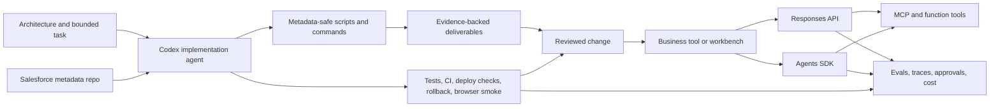

## A plan becomes real when it becomes a repo

A good architecture note is still an idea. The work becomes real when another person can clone the repo, run the command, inspect the evidence, and get the same answer.

I use Claude while the problem is still fuzzy. I use Codex once the direction needs to become files.

For a Salesforce org scan, those files include inventory scripts, structured metadata output, Markdown deliverables, validation checks, tests, CI, deployment notes, rollback steps, and smoke tests. For a business tool, they include the API contract, runtime tools, guardrails, evals, traces, and the product surface that an operator will actually use.

Codex earns its keep close to the repo. It can trace an unfamiliar codebase, run metadata-safe commands, make a small edit, prove the result, and leave the project easier for the next builder to understand. It should not silently change production or substitute a confident explanation for a test.

<div class="proof-strip">
  <div>
    <strong>Turn plans into files</strong>
    <span>Encode the thinking in scripts, docs, tests, evals, commands, and pull requests.</span>
  </div>
  <div>
    <strong>Keep the boundary executable</strong>
    <span>Enforce metadata-only access in tools and tests, not only in a prompt.</span>
  </div>
  <div>
    <strong>Make proof routine</strong>
    <span>Run the checks, capture the result, and let the release path expose weak assumptions.</span>
  </div>
</div>

## Where Codex helps

Codex works best when the target is bounded. Give it a repo, operating rules, known-safe commands, and a definition of done. A broad request such as `improve this org` creates theater. A request to inventory Flow metadata, write structured output, and validate the evidence boundary creates something reusable.

<div class="workflow-grid">
  <article>
    <p class="playbook-card-title">Org scan automation</p>
    <p>Write commands that inventory Salesforce metadata, packages, automation, permissions, integrations, reports, and deployment shape without touching record data.</p>
    <p><strong>Proof:</strong> the scan can be rerun and produces the same evidence shape every time.</p>
  </article>
  <article>
    <p class="playbook-card-title">Evidence-backed deliverables</p>
    <p>Build and maintain the executive overview, technical deep dive, improvement backlog, and process map from safe metadata evidence.</p>
    <p><strong>Proof:</strong> every important conclusion has a label and a source path or safe inspection method.</p>
  </article>
  <article>
    <p class="playbook-card-title">Integration discovery</p>
    <p>Extract source systems, targets, API touchpoints, middleware references, named credentials, events, and ownership questions from the repo.</p>
    <p><strong>Proof:</strong> dependencies become visible before a workflow change or migration.</p>
  </article>
  <article>
    <p class="playbook-card-title">Migration preparation</p>
    <p>Create object maps, field maps, transformation drafts, data-quality checks, validation scripts, and cutover notes from approved evidence.</p>
    <p><strong>Proof:</strong> source and target gaps are visible while there is still time to make a decision.</p>
  </article>
  <article>
    <p class="playbook-card-title">Release-path repair</p>
    <p>Add tests, CI, validation scripts, deployment docs, rollback instructions, release checks, and browser smoke tests where the UI matters.</p>
    <p><strong>Proof:</strong> a narrow fix can move safely without waiting for a heroic release effort.</p>
  </article>
  <article>
    <p class="playbook-card-title">Tech debt repair</p>
    <p>Turn one accepted finding into a scoped change: fix a brittle test, remove duplication, harden a script, repair stale docs, or close a deployment gap.</p>
    <p><strong>Proof:</strong> the next change is easier than the last one.</p>
  </article>
</div>

## Keep implementation and runtime separate

Codex changes the system. OpenAI APIs run model behavior inside the system. Keeping that split visible prevents the product architecture from turning into a pile of overlapping agent concepts.

Codex belongs near the source tree and terminal. It reads metadata, traces scripts, edits files, runs checks, captures evidence, and prepares a reviewable change. Use the Responses API or Agents SDK when the application itself needs reasoning, structured output, tool calls, state, handoffs, guardrails, or traces.

A report generator may need Codex and shell commands but no model runtime. A live org workbench may need both. Add the runtime only when an operator has a real interaction that requires it.

[Kicksights](https://kicksights.com/) is where I am applying this direction. It helps consultancies and smaller teams read a Salesforce org, keep the parts that still work, and create a practical exit path when a purpose-built tool is the better fit.



### Product boundaries

| Layer | Use it for | Keep it away from |
|---|---|---|
| Codex | Repo inspection, scripts, docs, implementation, debugging, tests, review, migration utilities, and release hardening. | Silent production changes, unauthorized org actions, default record-data access, or bypassing CI. |
| Responses API | Runtime reasoning, structured output, tool calls, hosted tools, state, and direct application workflows. | Repo work that is clearer as code, a command, or a reviewed Codex change. |
| Agents SDK | Code-first workflows with specialists, handoffs, sessions, guardrails, and tracing. | Small one-shot calls where a direct Responses request is easier to understand. |
| MCP servers | Narrow access to approved docs, metadata indexes, internal APIs, file stores, and specialized systems. | Broad access, secrets exposure, or unbounded business-data retrieval. |
| OpenClaw and local AI | Private exploration, offline work, low-risk drafts, and operator education. | High-stakes production decisions without evals, logs, and ownership. |

## Make the repo legible first

Codex needs the same handles a strong engineer would ask for: real commands, safe boundaries, examples, tests, environment notes, and a definition of done.

Before asking for serious implementation work, make these files easy to find:

```text
AGENTS.md
README.md
.env.example
justfile or package scripts
docs/architecture.md
docs/decisions/
scripts/org-scan/
scripts/smoke-*.*
tests/
evals/
playwright/
```

Use `AGENTS.md` as the operating contract. Keep it specific enough that the agent can act without guessing.

```markdown
# Agent Instructions

## Project goal
Turn org discovery into practical business tools, safer migrations, and faster validated releases.

## Commands
- Build: `just build`
- Unit tests: `just test`
- Org scan: `just org-scan`
- Local smoke: `just smoke-local`
- UI smoke: `just smoke-ui`
- Evals: `just eval`

## Data boundary
- Start with metadata.
- Do not retrieve Salesforce record rows or report results.
- Do not inspect files, logs, payloads, or exports that may contain business data.
- Mark questions that require record data as `Unknown` and add them to discovery.

## Boundaries
- Do not edit production secrets.
- Do not deploy or modify org metadata without explicit approval.
- Prefer small commits with verification evidence.
- Use official documentation for OpenAI product behavior.

## Done means
- The code or documentation is implemented.
- Relevant tests, evals, smoke checks, or builds pass.
- Risky actions stop at an approval gate.
- Findings cite safe evidence.
- Documentation matches the changed behavior.
```

### Give Codex a task it can finish

| Task | Mode | Useful request |
|---|---|---|
| Inspect | Ask | `Trace the repo and list safe metadata evidence sources. Do not inspect record data.` |
| Inventory | Code | `Create a metadata-only scan command that counts components and writes structured JSON.` |
| Generate deliverables | Code | `Update the four Markdown reports from scan output. Label conclusions Confirmed, Inferred, or Unknown.` |
| Implement | Code | `Fix this release-path problem. Keep the change small, run checks, and report changed files.` |
| Verify | Ask or code | `Run build, tests, evals, and browser smoke. Separate expected auth gates from failures.` |
| Review | Ask | `Review this diff for bugs, unsafe access, missing tests, and deployment risk.` |
| Operationalize | Code | `Turn this manual migration checklist into repo-native commands and documentation.` |

A useful task has a boundary, an artifact, and a check. Without all three, the agent has to invent part of the assignment.

## Encode the data boundary

For org scans, the prompt is only the first layer. The scripts, tool schemas, fixtures, evals, and review checks must enforce the same rule.

Do not retrieve Salesforce business data, user data, record rows, report results, samples, file contents, messages, payloads, or debug logs by default. Redacting after retrieval is too late.

Safe evidence includes:

- local Salesforce metadata source
- Metadata API, Tooling API, schema describe, and inventory calls
- object, field, relationship, record type, picklist, layout, app, tab, and permission metadata
- packages, automation, integration configuration, and deployment metadata
- component counts and active or inactive state
- named credentials and integration shape without secrets, tokens, certificates, usernames, or payload examples

When the evidence cannot answer the question, Codex writes `Unknown` and adds a concrete follow-up. That is safer and more useful than guessing from field names.

### Four durable deliverables

| File | Codex responsibility |
|---|---|
| `01-executive-overview.md` | Keep the business explanation concise and tied to safe evidence. Show what the org appears to do, the largest risks, and the first useful moves. |
| `02-technical-deep-dive.md` | Map objects, record types, Flows, Apex, validation rules, UI, permissions, packages, integrations, tests, and release configuration. |
| `03-improvement-areas-and-open-questions.md` | Maintain the blunt backlog: quick wins, structural work, high-risk areas, blind spots, blockers, and safe next inspections. |
| `04-business-process-system-map.md` | Build the onboarding guide with Mermaid diagrams, numbered narratives, lifecycle maps, and process-to-metadata references. |

Major conclusions use one of three labels:

- `Confirmed`: directly supported by a source path or safe metadata inspection.
- `Inferred`: supported by naming, structure, formulas, Flow labels, or correlated configuration, but still interpretive.
- `Unknown`: not provable within the current evidence and data boundary.

### Make the commands real

```bash
just org-scan
just org-scan-docs
just org-scan-validate
just test
just smoke-ui
```

Create these commands only when the repo can support them. A documented command that does not work creates more confusion than an honest manual step.

## Add a model runtime only when the product needs one

Use the Responses API when the application owns the orchestration loop and needs direct model reasoning, tools, state, or structured output.

For an org workbench, the runtime should start read-first. The tool below can look up an approved metadata component. Its contract prevents record data from entering through that path.

```typescript
import OpenAI from "openai";

const openai = new OpenAI();

const tools = [
  {
    type: "function",
    name: "lookup_metadata_component",
    description: "Look up a Salesforce metadata component by type and API name. Never returns record data.",
    parameters: {
      type: "object",
      properties: {
        component_type: { type: "string" },
        api_name: { type: "string" }
      },
      required: ["component_type", "api_name"],
      additionalProperties: false
    }
  }
];

export async function explainOrgFinding(input: string) {
  return openai.responses.create({
    model: "gpt-5.5",
    instructions: [
      "Explain Salesforce org findings from metadata only.",
      "Do not request or infer record-level data.",
      "Label conclusions Confirmed, Inferred, or Unknown."
    ].join(" "),
    input,
    tools,
    metadata: {
      workflow: "org_scan",
      data_boundary: "metadata_only"
    }
  });
}
```

The tool contract carries more weight than a clever prompt:

- Keep the input schema narrow.
- Enforce the data boundary before returning a result.
- Log request, actor, arguments, status, and latency.
- Make reads idempotent and require explicit approval for writes.
- Return `Unknown` when the requested evidence is unavailable.

## Use specialists when the work has real phases

The Agents SDK fits when the workflow needs specialists, handoffs, guardrails, tracing, or durable state. One agent can explain an org. A serious delivery loop usually has distinct jobs with different tools and approval rules.

```python
from agents import Agent, Runner, function_tool

@function_tool
def search_metadata_index(query: str) -> str:
    """Search approved Salesforce metadata inventory. Never returns record data."""
    return "matching metadata evidence..."

org_explainer = Agent(
    name="Org explainer",
    instructions=(
        "Explain Salesforce org behavior from metadata evidence only. "
        "Label every major conclusion Confirmed, Inferred, or Unknown."
    ),
    tools=[search_metadata_index],
)

result = Runner.run_sync(
    org_explainer,
    "Summarize where onboarding logic appears to live and what needs more discovery."
)

print(result.final_output)
```

### A useful specialist split

| Specialist | Job | Tools |
|---|---|---|
| Metadata inventory | Count and index components. | Local files, Salesforce describe, Tooling inventory. |
| Org explainer | Turn metadata into a careful business-process interpretation. | Metadata index, architecture docs, source references. |
| Integration mapper | Find systems, events, source-of-truth questions, and ownership gaps. | Named credential inventory, custom metadata, platform events, docs. |
| Migration readiness | Draft mappings, transformation candidates, validation, and cutover risk. | Metadata index, approved mapping docs, validation scripts. |
| Pipeline repair | Harden tests, CI, release notes, rollback, and browser smoke checks. | Shell, test runner, Playwright, GitHub Actions. |
| QA reviewer | Check evidence labels, unsafe access, unsupported claims, and regression risk. | Evals, traces, diff review, policy checklist. |

Use a handoff when one specialist owns the next phase. Expose a specialist as a tool when a manager needs to retain control of the final artifact.

## Keep MCP boring and narrow

MCP is useful when the boundary is clear. Start with the OpenAI Docs MCP when current API, Agents SDK, or Codex guidance is needed during implementation.

```bash
codex mcp add openaiDeveloperDocs --url https://developers.openai.com/mcp
codex mcp list
```

Add project-specific servers only when each tool has one obvious job.

| Server | Read access | Write access | Approval |
|---|---|---|---|
| Docs | Search and fetch official documentation. | None. | None. |
| Salesforce metadata | Describe objects, fields, layouts, Flows, Apex, permissions, and packages. | None by default. | Required for metadata writes. |
| Files | Read approved workspace folders and generated scan artifacts. | Write reports and structured output. | Required outside the workspace. |
| GitHub | Read issues, pull requests, checks, and workflow logs. | Create branches, commits, comments, or pull requests. | Required for publishing. |
| Deploy | Read build, preview, and health status. | Trigger deploy or rollback. | Required. |

Every tool needs an explicit schema, permission check, structured result, and a plan for errors. A tool that can read everything will eventually read something it should not.

## Design for the plausible wrong answer

Assume the model will eventually choose the wrong tool, read too much context, or produce a clean explanation that outruns the evidence. The control layer is how the product recovers.

| Control | Implementation |
|---|---|
| Data boundary | Block record queries, report results, list views, files, payloads, logs, and sample rows unless separately approved. |
| Tool guardrail | Validate arguments before execution and refuse unsafe access. |
| Output guardrail | Check reports for unsupported claims, missing labels, secrets, or accidental data references. |
| Approval gate | Stop before writes, external messages, deploys, metadata changes, billing changes, or customer-impacting actions. |
| Trace | Capture model calls, tools, handoffs, guardrails, latency, cost, source versions, and final output metadata. |
| Sensitive-data mode | Redact or disable sensitive trace payloads where the workflow requires it. |

### Write-safety tiers

| Tier | Behavior | Example |
|---|---|---|
| 0: Metadata read | Summarize, retrieve, compare, and classify. | Explain automation structure without record rows. |
| 1: Draft | Prepare a report or change for review. | Draft migration notes or a validation checklist. |
| 2: Approved repo write | Edit local files inside a clear review boundary. | Add a scan script, test, doc, or CI check. |
| 3: Approved org or deploy action | Execute after explicit approval and validation. | Deploy metadata or trigger a release. |
| 4: Restricted | Do not execute directly. | Read customer records, approve money, change contracts, delete production data, or bypass compliance. |

## A demo is an anecdote; a regression set is evidence

Every workflow needs a regression set before the team trusts it. Use cases from the real work rather than a generic benchmark.

```text
evals/
  org_scan_findings.jsonl
  metadata_boundary_cases.jsonl
  integration_mapping.jsonl
  migration_readiness.jsonl
  pipeline_hardening.jsonl
  prompt_injection_cases.jsonl
```

Each case should carry:

- the task request
- the safe source context
- allowed tools
- expected output shape
- required evidence labels
- forbidden access and tool calls
- expected escalation behavior
- a pass or fail rubric a reviewer can explain

### Release gate

```bash
just build
just test
just org-scan-validate
just eval
just smoke-local
just smoke-ui
just deploy-preview
```

Do not ship because the happy path worked once. Ship when the regression set, logs, operator review, and release pipeline agree that the workflow is useful and bounded.

## Smallest useful prototype: the org scan workbench

The prototype should prove the full evidence path without pretending the whole operating model is finished.

The workbench needs:

- connect an approved metadata repo and metadata-only org access
- run the scan from repo-native commands
- generate the four Markdown deliverables
- index components with source paths and evidence labels
- show integration, migration, permission, and release risk
- answer questions from approved metadata evidence
- stop before any write, deploy, or deeper access
- store traces, eval scores, versions, and reviewer feedback

### Build sequence

1. Add repo-native scan commands and structured output.
2. Encode the no-record-data policy in `AGENTS.md`, scripts, tool descriptions, and evals.
3. Generate the first four deliverables from safe evidence.
4. Validate evidence labels, links, Mermaid syntax, and unsafe terms.
5. Add tests, CI, deployment notes, rollback, and browser smoke checks where needed.
6. Add a Responses endpoint or Agents SDK workflow only if the product needs a runtime assistant.
7. Build eval packs for findings, mapping, migration, permission boundaries, and prompt injection.
8. Pilot against one serious org and compare the output with consultant review.

## Completion checklist

| Area | Done when |
|---|---|
| Repo | Codex can build, test, smoke, scan, and read its boundaries from `AGENTS.md`. |
| Data boundary | Metadata-only behavior is enforced in prompts, scripts, tool schemas, evals, and review. |
| Scan | The command produces reusable structured output with safe evidence references. |
| Deliverables | The four reports carry evidence labels and source paths. |
| Pipeline | CI can build, test, validate reports, run evals, deploy preview, and smoke the UI where needed. |
| Runtime | The product uses Responses or Agents SDK for a deliberate reason. |
| Tools | Each tool is narrow, typed, logged, permission-aware, and idempotent where possible. |
| MCP | Servers begin read-only and exist for a specific capability. |
| Local AI | Local models have a defined job such as private review, offline work, low-risk drafting, or operator education. |
| Observability | Traces, tool calls, guardrails, cost, latency, approvals, and feedback are inspectable. |

## Official references

- [Building an AI-Native Engineering Team](https://developers.openai.com/codex/guides/build-ai-native-engineering-team)
- [Codex web](https://developers.openai.com/codex/cloud)
- [Code generation with Codex and OpenAI models](https://developers.openai.com/api/docs/guides/code-generation)
- [Migrate to the Responses API](https://developers.openai.com/api/docs/guides/migrate-to-responses)
- [OpenAI tools guide](https://developers.openai.com/api/docs/guides/tools)
- [Agents SDK guide](https://developers.openai.com/api/docs/guides/agents)
- [Agents SDK tools](https://openai.github.io/openai-agents-python/tools/)
- [Agents SDK guardrails](https://openai.github.io/openai-agents-python/guardrails/)
- [Agents SDK tracing](https://openai.github.io/openai-agents-python/tracing/)
- [OpenAI evals guide](https://developers.openai.com/api/docs/guides/evals)
- [OpenAI Docs MCP](https://developers.openai.com/learn/docs-mcp)
