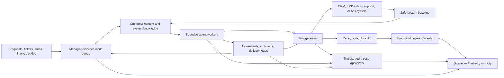
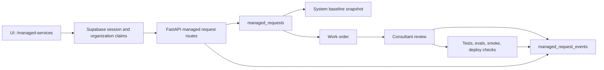
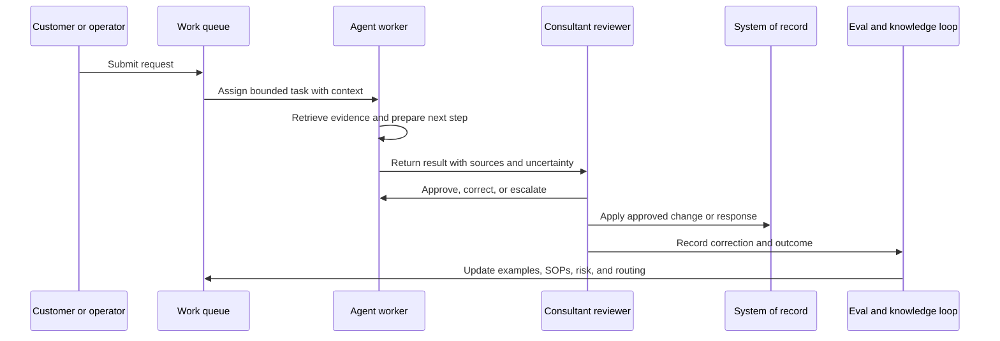

## A work queue tells the truth

A managed-services queue is a better test of an agent system than a polished chat window.

The queue contains half-formed requests, old decisions, production risk, impatient users, and work that still has to land. Imagine a request that says an invoice stopped syncing. The useful context sits across a ticket, an integration map, last month's release notes, a Salesforce baseline, and the memory of the consultant who fixed it before.

An agent can summarize the ticket. Moving the work safely requires more: a durable request, current system context, an owner, a risk level, a review path, validation, rollback, and a record of what happened.

The platform is an operating layer for implementation, support, migration, and release work around systems of record. Agents handle bounded inspection and preparation. People make the decisions that carry customer, production, or financial consequence.

Salesforce is the concrete example because it is familiar, integrated, permission-heavy, and hard to pause while the team improves it. The same pattern applies to an ERP, billing system, support platform, warehouse system, loan origination system, or internal operations tool. The names change. The operating problem does not.

  

    <strong>Use real work</strong>
    Start with requests, incidents, scans, migrations, releases, and support work the team already owns.
  

  

    <strong>Bound the agent</strong>
    Agents inspect, compare, draft, and test. People review, approve, sequence, and own the relationship.
  

  

    <strong>Make state visible</strong>
    Every request carries context, owner, risk, evidence, status, review history, and the next required action.
  

## Start with the boring system

Build the work object before the agent.

Use the existing authentication model, the existing ticket or intake source, a small relational schema, a typed API, a plain queue UI, an event stream, and repo-native checks. Add agent workers after the request, context, approval path, and validation loop are concrete.

For Salesforce, the context layer includes metadata, permissions, integrations, releases, and system baselines. In another domain, it may contain ServiceNow configuration, NetSuite scripts, Zendesk routing, billing rules, warehouse workflows, or product telemetry. The source changes while the operating contract remains recognizable.

This order matters. A model call is easy to add. Durable state, access control, correction history, and a trustworthy release path take the real work.

## Why managed services is the right proving ground

Managed-services teams do the same broad categories of work every week: explain the system, triage issues, clean up old decisions, prepare releases, migrate data, answer customer questions, and keep the business moving.

The details are messy, but the work is measurable.

- The request has an owner and an outcome.
- Reviewers sit close enough to correct weak output quickly.
- The task crosses business and technical boundaries.
- The system of record requires permissions, audit, and approval.
- The backlog has repetition, but each customer still brings context and exceptions.

That last point is the opportunity. Agents can handle more inspection, comparison, drafting, testing, and documentation. Consultants can spend more time on diagnosis, architecture, sequencing, and the customer decisions that cannot be inferred from metadata.

## Workloads worth supporting first

A useful first version handles work a real delivery team already sees.

  <article>
    
Support triage

    
Classify the request, find missing context, connect it to the system map, and distinguish a bug from a training issue, configuration change, data problem, or architecture problem.

    
<strong>Proof:</strong> faster first response and fewer tickets bouncing between people.

  </article>
  <article>
    
System scan and explainer

    
Run safe scans, explain configuration and automation, flag land mines, and keep a current-state map ready before anyone recommends a change.

    
<strong>Proof:</strong> a new consultant can understand the system without a week of Slack archaeology.

  </article>
  <article>
    
Tech debt queue

    
Turn stale fields, brittle automation, weak tests, permission drift, and release friction into evidence-backed work with a clear owner.

    
<strong>Proof:</strong> accepted findings become smaller future changes instead of permanent backlog.

  </article>
  <article>
    
Release readiness

    
Prepare deployment notes, improve tests, validate rollback, review impacted components, and surface unresolved risk before the release window.

    
<strong>Proof:</strong> fewer surprises and a shorter path from finding to reviewed fix.

  </article>
  <article>
    
Migration readiness

    
Map systems, fields, transformations, validation, cutover sequence, and the repeatable path for loading and reconciling data.

    
<strong>Proof:</strong> migration risk becomes visible before the team is under cutover pressure.

  </article>
  <article>
    
Escalation packets

    
Assemble the issue, evidence, suspected cause, affected workflow, open questions, recommendation, and the decision needed from the customer or delivery lead.

    
<strong>Proof:</strong> the escalation arrives ready for a decision.

  </article>

## The platform is a control plane around the work

The platform can sit beside Jira, Slack, GitHub, Salesforce, ServiceNow, Zendesk, NetSuite, and customer systems. It does not need to replace them on day one. Its job is to make delivery work visible, bounded, reviewable, and easier to improve.

### Platform primitives

| Primitive | Job | Operating consequence |
|---|---|---|
| Intake classifier | Tag work by customer, workflow, system area, urgency, risk, and likely owner. | The queue stops acting like a junk drawer. |
| Context layer | Store scan output, diagrams, implementation notes, decisions, configuration, and current risk. | Humans and agents begin from the same system picture. |
| Agent task runner | Execute bounded jobs such as explain, compare, draft, validate, test, summarize, or prepare. | Repeated work becomes observable and reviewable. |
| Tool gateway | Provide narrow access to configuration, repos, docs, tickets, and approved systems. | Automation can help without gaining uncontrolled reach. |
| Human review | Assign approvals, escalation, QA, architecture, and customer decisions. | Judgment and relationship ownership remain visible. |
| Evaluation layer | Replay accepted examples, boundary cases, tool checks, and release gates. | The team can tell whether the system is improving. |
| Visibility dashboard | Show queue health, risk, review load, corrections, latency, cost, and outcomes. | A manager can run the hybrid workflow from evidence rather than intuition. |

## Kicksights as the concrete implementation

Kicksights is where I am working through this problem. Salesforce provides the right constraints: dense metadata, old automation, permissions, integrations, migration pressure, release risk, and users who still need the system while it changes.

As of the date on this playbook, the first Kicksights slice models an authenticated managed-services workspace, persisted requests, baseline references, draft work orders, event history, and a path back to system evidence. The finished cooperative platform remains a proposed direction. The existing slice is useful because it gives the idea real state and boundaries.

The Salesforce labels are implementation details. In another domain, `managed_requests` and `managed_request_events` can stay. `salesforce_work_orders` can become `delivery_work_orders`, `org_connections` can become `system_connections`, and `baseline_snapshot_id` can point to the current map of any supported system.

### What the first slice models

| Piece | Kicksights shape | Why it matters |
|---|---|---|
| Workspace | `/managed-services` lets a user open a request, choose work type, priority, delivery risk, reviewer, and an optional system baseline. | Humans and agents can work from the same intake object. |
| Request types | Admin or configuration, automation, integration, migration, reporting, security, release promotion, and discovery. | The queue begins with recognizable delivery work. |
| Lifecycle | Submitted, triaging, needs clarification, scoped, queued, building, validating, ready for review, approved, promoting, done, blocked, canceled. | Stuck work and the next owner become visible. |
| Next actor | Intake, blueprint, architect, builder, QA, release, migration, or client. | Routing can work before every specialist is automated. |
| System baseline | A request can pin a baseline snapshot or use the latest ready baseline. | Scope begins from current evidence instead of memory. |
| Work order | Scope, exclusions, affected components, acceptance, validation, rollback, artifacts, and audit references. | Intake, architecture, build, QA, and approval share one delivery contract. |
| Event stream | Submissions, updates, clarifications, decisions, and work-order drafts are stored as events. | Corrections and decisions become product signal. |
| Access control | Supabase JWT validation, server-side organization resolution, and RLS for organization-owned records. | One customer's work does not leak into another workspace. |

Durable state comes before autonomy. Once the request, baseline, event stream, and work-order contract exist, an agent has something specific to act on and a place to record what it did.

### Concrete stack

| Layer | Implementation pattern |
|---|---|
| Frontend | Next.js and React workspace with typed API normalization, status buckets, routing controls, technical references, activity history, and work-order views. |
| Worker | FastAPI routes to create, list, retrieve, and update requests; list events; draft work orders; record clarifications; approve or reject; register connections; and pin baselines. |
| Database | Supabase Postgres tables for `org_connections`, `managed_requests`, `managed_request_events`, and `salesforce_work_orders`, indexed for organization, status, baseline, and request lookups. |
| Access | Supabase Auth, JWT claim resolution, server-side organization lookup, and RLS policies for organization-scoped visibility. |
| Context | Org overview and OKG snapshots provide the Kicksights baseline. Another product could use configuration snapshots, dependency maps, workflow traces, or graph output. |
| Reliability | Repo-native commands for builds, worker tests, local route smoke, deploys, baseline operations, and prompt rollout checks. |
| Evals | Offline org-spec and prompt-contract evaluators with thresholds before stronger blocking behavior is enabled. |
| Live verification | Local smoke can classify expected auth gates. Protected staging and production flows require real sessions because the worker validates JWTs. |

### API contract

| Endpoint | Job |
|---|---|
| `POST /managed-requests` | Create the request, resolve user and organization, attach the latest baseline when available, set risk and next actor, and write `request.submitted`. |
| `GET /managed-requests` | List organization-scoped work with status, limit, and offset filters. |
| `GET /managed-requests/{request_id}` | Return one request with its events and work orders. |
| `PATCH /managed-requests/{request_id}` | Update status, priority, risk, next actor, scope, artifacts, and audit references. |
| `GET /managed-requests/{request_id}/events` | Return the chronological decision and activity stream. |
| `POST /managed-requests/{request_id}/clarifications` | Record a question or answer and move the request through clarification and triage. |
| `POST /managed-requests/{request_id}/work-orders` | Draft scope, validation, rollback, affected components, artifacts, and audit references. |
| `POST /managed-requests/{request_id}/approve` | Move work to `approved` or `blocked` and assign the next actor. |
| `POST /org-connections` | Register source, target, sandbox, UAT, archive, or client-managed systems. |
| `POST /org-connections/{org_connection_id}/baseline` | Pin a connection to a baseline snapshot and status. |

## Build one layer deeper than the demo

1. **Create the work object.** A `managed_requests` record needs `org_id`, `type`, `priority`, `status`, `title`, `business_goal`, `risk_level`, `next_required_actor`, `baseline_snapshot_id`, `artifacts`, `audit_refs`, and `intake_payload`.
2. **Add the event stream.** Submissions, edits, clarifications, approvals, rejected work orders, validation, deploy attempts, and customer decisions all become events. This is the memory of the system.
3. **Pin system context.** Attach the latest baseline when possible. Missing context raises risk for migration, integration, security, and release work until a person reviews it.
4. **Generate a work order.** Replace loose recommendations with scope, exclusions, affected components, acceptance criteria, validation, rollback, artifacts, and audit references.
5. **Give each agent a bounded transition.** Intake requests missing detail. Blueprint finds evidence. Architecture drafts scope. Build proposes a change. QA runs checks. Release prepares promotion and rollback evidence.
6. **Gate every consequential write.** Production changes, metadata deploys, customer messages, contract decisions, and data movement wait for human approval.
7. **Put evals in the release path.** Replay golden requests, unsafe tool cases, boundary cases, and reviewer corrections before trusting new behavior.
8. **Give managers an operating view.** Show request status, stuck work, next actor, baseline coverage, reviewer burden, correction rate, eval failures, cost, latency, and customer risk.

The model call is the easy layer. The product is the work object, context, permissions, review, validation, and feedback that let people and agents move real work without losing control.

## Divide the work by consequence

Agents are useful when the task is bounded and evidence can be checked. People remain responsible for judgment, sequencing, taste, customer trust, and the exceptions that change the plan.

| Work | Agent contribution | Human ownership |
|---|---|---|
| Support triage | Classify, summarize, find related evidence, and identify missing context. | Priority, customer tone, owner, and escalation path. |
| System analysis | Scan configuration, group findings, cite sources, and mark unknowns. | What matters, what to ignore, and what to ask next. |
| Implementation prep | Draft code, tests, deployment notes, and rollback steps. | Architecture, scope approval, review, and merge. |
| Migration planning | Draft mappings, validation needs, and open questions. | Source of truth, acceptable tradeoffs, cutover, and loss. |
| Knowledge updates | Suggest SOP or routing changes from repeated work and corrections. | Durable policy and process changes. |
| Customer communication | Draft explanations and escalation packets. | Sending, relationship ownership, and commitments. |

The operating rule is simple: an agent may move the request forward. Production changes, customer commitments, compliance decisions, and cases with missing evidence stop for human review.

## Corrections are product signal

The platform improves because the work is instrumented. It can show where an agent helped, where a reviewer corrected it, and where the operating process itself created the problem.

The rejection reason matters more than the red score. Was the context stale? Was a tool missing? Did the SOP fail? Did the agent cross a permission boundary? Was this a real edge case? Each answer points to a different product change.

## Evaluate the work people are paying for

Skip generic benchmarks. Define what useful work looks like, then replay it. A compact rubric can use `-1`, `0`, and `1`: harmful or wrong, incomplete, useful after review.

| Area | Question | Pass standard |
|---|---|---|
| Task success | Did the agent complete the support, scan, release, or migration task? | A reviewer can take the next action. |
| Evidence | Did it cite configuration, docs, tickets, metadata, or repo paths? | Major claims have sources or remain explicitly unknown. |
| Tool use | Did it choose the right tool and safe arguments? | No broad scraping, unsafe record access, or invented tool capability. |
| Permissions | Did it respect customer, system, repo, and data boundaries? | Consequential actions stop at approval. |
| Escalation | Did it ask for help when confidence fell or risk rose? | A person receives the case with a concrete reason. |
| Regression | Did the change preserve known good behavior? | Golden cases and release checks remain green. |
| Review burden | Did the system save more time than it created? | Corrections become smaller and less frequent. |
| Cost and latency | Is the workflow worth repeating? | Runtime, cost, and review effort fit the value of the task. |

## Pilot one customer and one queue

Start with support triage and escalation packets for one customer running a serious system of record. Salesforce is a useful example, but the pilot is testing the operating model rather than the CRM vocabulary.

  <section>
    
Days 0-30: one queue, one customer, real evidence

    
<strong>Objective:</strong> make the support workflow visible and reviewable.

    <ul>
      <li>Connect one intake source and customer workspace.</li>
      <li>Run the safe system scan and create the first context baseline.</li>
      <li>Classify work by system area, risk, urgency, owner, and missing detail.</li>
      <li>Generate escalation packets for review.</li>
      <li>Track corrections, approvals, time, and unresolved questions.</li>
    </ul>
    
<strong>Exit:</strong> the team can see the queue, trust the evidence, and review agent work without reconstructing context by hand.

  </section>
  <section>
    
Days 31-60: connect support to delivery

    
<strong>Objective:</strong> turn repeated findings into reviewed implementation work.

    <ul>
      <li>Convert recurring issues into scoped backlog items and work orders.</li>
      <li>Add tests, documentation checks, deployment notes, rollback, and browser smoke where needed.</li>
      <li>Create evals from accepted and rejected outputs.</li>
      <li>Add approval gates for code, configuration, metadata, data movement, and customer-facing actions.</li>
    </ul>
    
<strong>Exit:</strong> repeated problems produce validated fixes and every change has a review path.

  </section>
  <section>
    
Days 61-90: make the loop portable

    
<strong>Objective:</strong> turn one customer workflow into a repeatable operating model.

    <ul>
      <li>Package intake, scan, escalation, eval, and release patterns.</li>
      <li>Add manager views for queue health, risk, review load, cost, latency, and outcome quality.</li>
      <li>Expand to a second workflow or customer only after the first loop is trusted.</li>
      <li>Document which parts generalize beyond Salesforce.</li>
    </ul>
    
<strong>Exit:</strong> the team can carry the same human and agent loop into another serious workflow.

  </section>

## The engineering manager stays close to the queue

This role remains hands-on. The manager shapes the work object, owns reliability, reads traces, talks to users, reviews architecture, and turns repeated friction into a better product primitive.

### Weekly rhythm

- Review queue health, stuck work, escalations, and reviewer burden.
- Pick one product improvement from a real operator problem.
- Read failed evals and rejected agent output.
- Turn repeated review into a better tool, prompt, SOP, or guardrail.
- Keep logs, permissions, deploys, rollback, tests, and ownership boring and dependable.
- Ship often enough that users keep giving honest feedback.

### Team shape

| Role | Ownership |
|---|---|
| Engineering manager | Architecture, focus, user loop, reliability, prioritization, and technical review. |
| Full-stack or product engineer | Queue, dashboard, workbench, workflow state, and operator experience. |
| AI or platform engineer | Agent workflows, tool gateway, traces, evals, guardrails, and model integration. |
| Systems or data engineer | Metadata ingestion, knowledge, reporting, audit, cost, and integrations. |
| Embedded consultant or operations lead | Diagnosis, acceptance criteria, customer context, and feedback quality. |

## Proof package

The public artifact should show one request moving through the whole system:

1. A managed-services request arrives for a system of record.
2. The platform classifies it and attaches current system context.
3. An agent prepares an escalation packet with evidence, uncertainty, and a proposed action.
4. A consultant corrects or approves the packet.
5. A repeated finding becomes a work order, test, SOP change, or release task.
6. The dashboard shows queue health, agent performance, review burden, cost, latency, and unresolved risk.

That is enough to test the idea. Swap Salesforce for another system of record and the same questions remain: What is the request? What context is current? What can the agent do? Where does a person decide? What proves the result? What does the system learn from the correction?
